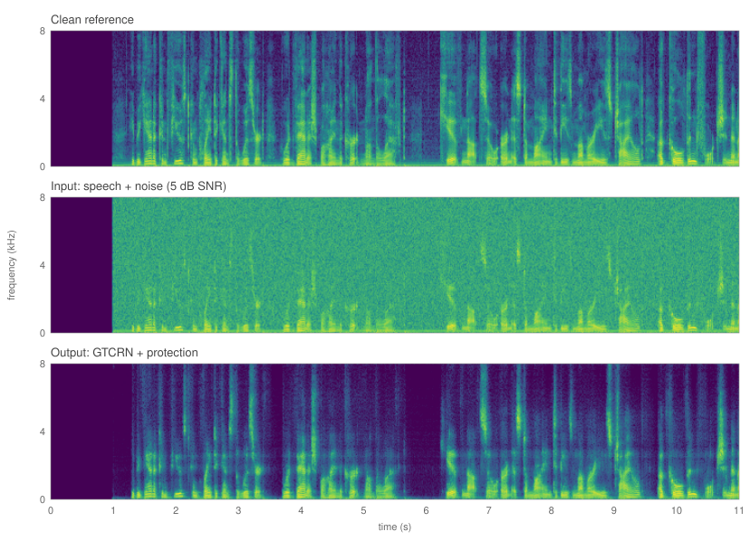
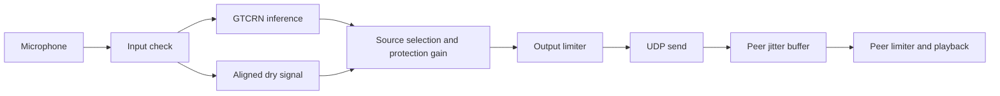

# Tactical Speech Enhancement

[](https://github.com/sungmin-park-dev/tactical-speech-enhancement/actions/workflows/ci.yml)

[한국어](README.ko.md)

A Python project for real-time speech denoising on low-power edge devices and
two-way voice between two Raspberry Pi 5 units over Wi-Fi or a hotspot. The
setting is voice communication in a defense context; this public version
covers single-microphone headset communication between two peers and the
software validation behind it.

Speech is processed with the streaming ONNX version of
[GTCRN](https://github.com/Xiaobin-Rong/gtcrn). When a large peak or clipping
is detected, the affected segment is muted, and gain is restored gradually once
the input is normal again. Preserving speech during a blast is not a goal.



*Spectrograms of the [background-noise example](#beforeafter-examples): clean reference, input with white noise and a 120 Hz tone at 5 dB SNR, and the processed output. Drawn with [make_spectrogram_figure.py](scripts/make_spectrogram_figure.py).*

## Processing pipeline



- **16 kHz, 256-sample frames:** 16 ms per frame, PCM16 voice to and from one peer.
- **Protection independent of inference:** the input is checked first. A slow
  or stalled model cannot block the protection decision or the send schedule,
  and a late result never lifts protection.
- **Conditional dry-signal fallback:** if only the model fails on healthy
  input, the delay-aligned input is sent instead. This bypass is not allowed
  during abnormal input or while protection is held.
- **Bounded queues:** dry-signal alignment is fixed at 2 frames. The target of
  4 and maximum of 8 frames applies only to the receive jitter buffer.
- **Output limits:** the final digital peak is limited to −6 dBFS on both the
  sending and the playback side. This is a digital limit, not a sound-pressure
  or hearing-protection figure.

Model, protection control, networking and audio-device handling are separate
modules, so that device measurements and later model comparisons can be
attributed to one part at a time.

## Install and process a file

Python 3.11 or later, run from the repository folder.

```sh
python3 -m venv .venv
. .venv/bin/activate
python -m pip install -e '.[audio,dev]'
tse model fetch
tse model verify
tse process tests/fixtures/speech/speaker-0061.wav output.wav
tse benchmark --frames 10000
```

The model download is checked against its SHA-256 and I/O signature. File
input must be mono 16 kHz; no automatic resampling is provided. Running with
audio devices requires PortAudio. All defaults are in
[software-defaults.toml](examples/software-defaults.toml):

```sh
tse --config examples/software-defaults.toml benchmark --frames 10000
```

## Before/after examples

11-second clips made from public speech with synthetic noise added. The first
second is silence used to complete start-up protection.

| Example | Input | Output |
|---|---|---|
| Background noise (5 dB SNR) | [noisy speech](examples/audio/noise-input.mp3) | [GTCRN output](examples/audio/noise-output.mp3) |
| Impulse and clipping | [speech with synthetic impulses](examples/audio/impulse-input.mp3) | [mute and recovery](examples/audio/impulse-output.mp3) |

A [clean reference](examples/audio/clean-reference.mp3) is included. Outputs
are not level-normalized. In the impulse example, speech inside the muted
segment is cut as well. These are file-processing results, not Raspberry Pi
recordings or quality scores. Generation settings and commands are in the
[audio example notes](examples/audio/README.md).

## Two-device run

Connect both devices to the same Wi-Fi or hotspot and list audio devices with
`tse devices`. Addresses and device numbers below are examples.

```sh
# Device A
tse peer --bind 192.0.2.10:5000 --peer 192.0.2.20:5000 \
  --input-device 1 --output-device 2 --duration 60 --report peer-a.json

# Device B
tse peer --bind 192.0.2.20:5000 --peer 192.0.2.10:5000 \
  --input-device 1 --output-device 2 --duration 60 --report peer-b.json
```

See the [Raspberry Pi guide](docs/raspberry-pi.md) for setup and diagnostics.
The link assumes a named peer on the same local network and provides no
application-level encryption or authentication.

## History

Work began in July 2025 with a review of real-time voice communication
setups. The first device build ran Facebook Research's
[denoiser](https://github.com/facebookresearch/denoiser) (Demucs-based) in real
time on Raspberry Pi 5 units in two helmet prototypes, with full-duplex voice over
Wi-Fi, and the model was then retrained starting from that denoiser. This
public version (September 2026) was rebuilt with a narrower scope around GTCRN:
single-microphone headset communication between two peers and its software
validation. Code and records from the earlier build are not included here.

## Validation and limits

| Scope | Status |
|---|---|
| Earlier device build (owner-reported) | Model inference on two Raspberry Pi 5 units and Wi-Fi/hotspot voice communication were achieved in the earlier implementation. Its code is not in this repository. |
| This public version | Processing and networking rebuilt and checked with fixed test inputs and automated tests: 187 tests pass with 0 skipped, locally and on GitHub Actions (Linux, Python 3.11 and 3.13). |
| Local latency (macOS arm64) | Mean 0.72 ms per 16 ms frame over 10,000 frames, max 2.94 ms, 0 frames over 16 ms. |
| Raspberry Pi measurements of this version | Not yet done. Speech quality, end-to-end latency and false-mute rate are unmeasured. |

The default thresholds and recovery times are initial values for software
testing. The next step is tuning input gain and timing on real devices and
comparing models under the same conditions.

```sh
python -m pytest
ruff check .
```

The speech tests use 10 fixed LibriSpeech utterances at three levels. Impulse,
clipping, malformed input, slow inference, packet errors and clock drift are
tested separately. Run `tse model fetch` before the model integration tests.

Detailed documents (in Korean):
[architecture](docs/architecture.md) ·
[validation](docs/validation.md) ·
[Raspberry Pi](docs/raspberry-pi.md) ·
[design notes](docs/development.md)

## License

Project code is [MIT](LICENSE); GTCRN is under its authors' MIT license; the
public speech test data is CC BY 4.0. Sources and changes are listed in
[THIRD_PARTY_NOTICES.md](THIRD_PARTY_NOTICES.md).
